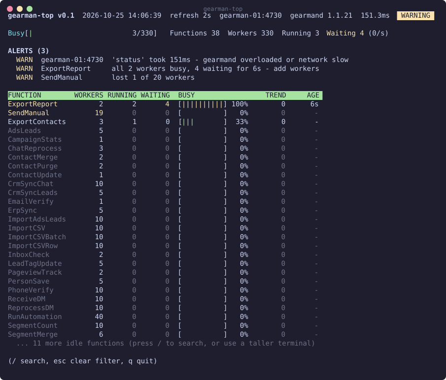
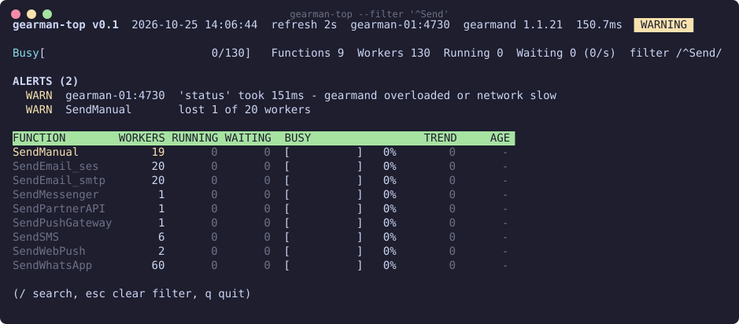
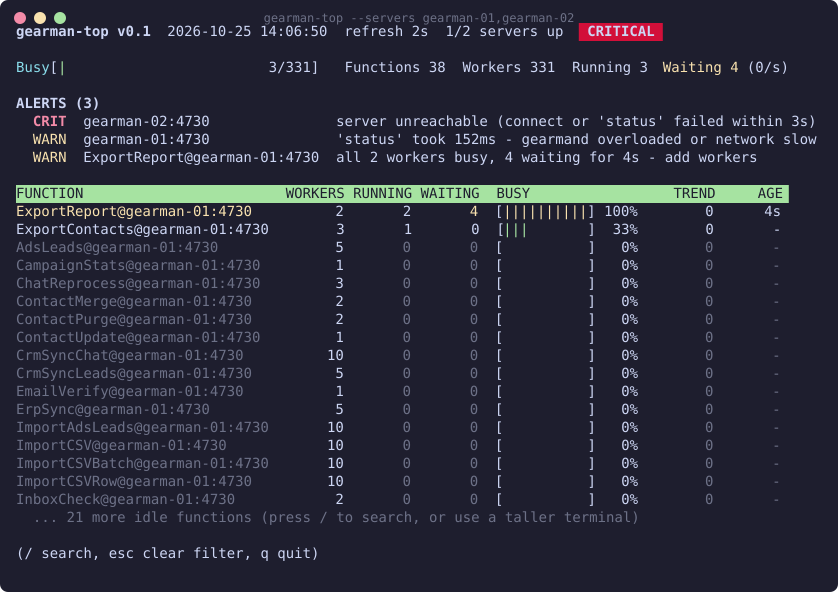

# gearman-top

`top` for [gearmand](http://gearman.org/): watch queues and workers in real time
and see at a glance when a queue is actually in trouble.

A friendlier `gearman_top` / `gearadmin --status`, in the style of htop and
glances. Single Perl script, core modules only, nothing to install.



## Features

- **Live table** of every function: workers, running, waiting, busy %, trend and age.
- **Alerts panel** that says what is wrong and what to do about it.
- **Worst first** sorting, cut to the terminal height, so problems never scroll off screen.
- **Multiple servers** in one view, with per-server health.
- **Live filter**: press `/` and type a regex.
- **Monitoring mode** (`--oneoff`) with Nagios-style exit codes.

## Install

```sh
curl -O https://raw.githubusercontent.com/raphaelgiovanini/gearman_top/main/gearman-top
chmod +x gearman-top
./gearman-top --servers gearman-01:4730
```

Needs Perl 5 (any modern system has it). It talks to gearmand's admin
protocol (`status`, `version`) on port 4730, so the machine running it must
reach that port.

## Usage

```sh
./gearman-top                                     # localhost:4730, refresh every 2s
./gearman-top --servers gearman-01,gearman-02:4731 --sleep 5
./gearman-top --filter '^Send'                    # only functions matching a regex
./gearman-top --oneoff                            # one snapshot, exit 0 OK, 1 WARNING, 2 CRITICAL
```

| Option              | Default          | Description                                         |
|---------------------|------------------|-----------------------------------------------------|
| `--servers h[:p],…` | `localhost:4730` | Servers to watch. Repeat the flag or comma-separate. |
| `--port N`          | `4730`           | Port used when a server has none.                   |
| `--sleep N`         | `2`              | Refresh interval in seconds. A bare number works too. |
| `--filter REGEX`    | none             | Show only matching functions.                       |
| `--oneoff`          | off              | Print once, no colors, no screen clearing.          |
| `--color` / `--nocolor` | color        | Toggle ANSI colors.                                 |

### Keys

| Key     | Action                                |
|---------|---------------------------------------|
| `/`     | Start a live filter (regex or text)   |
| `Enter` | Keep the filter                       |
| `Esc`   | Clear the filter                      |
| `q`     | Quit                                  |



## What it flags

| Level     | Condition                                                             |
|-----------|-----------------------------------------------------------------------|
| CRIT      | Jobs waiting on a function with no workers                            |
| CRIT      | All workers of a function gone                                        |
| CRIT      | Server unreachable                                                    |
| WARN/CRIT | All workers busy with jobs waiting (saturation), by queue size and wait time |
| WARN/CRIT | Jobs waiting while workers sit idle (stuck workers)                   |
| WARN      | Lost workers compared to the peak seen this session                   |
| WARN/CRIT | Slow `status` round-trip                                              |

With several servers, rows read `function@server` and a down server turns the
whole screen CRITICAL:



### Reading the table

- **BUSY**: running / workers.
- **TREND**: change in waiting jobs per second. Positive means the queue is growing.
- **AGE**: how long the function has had jobs waiting nonstop.
- Idle functions are dimmed.

### Thresholds

Edit `%limit` at the top of the script. Each metric has a warning and a
critical level:

```perl
my %limit = (
  waiting  => [100, 1000],   # jobs queued for one function
  wait_age => [60, 300],     # seconds with jobs waiting nonstop
  latency  => [50, 250],     # ms for one 'status' round-trip
);
```

## Monitoring (Nagios, cron, CI)

`--oneoff` prints a plain-text snapshot and exits with the overall status:

```sh
./gearman-top --servers gearman-01 --oneoff > /dev/null
echo $?   # 0 OK, 1 WARNING, 2 CRITICAL
```
